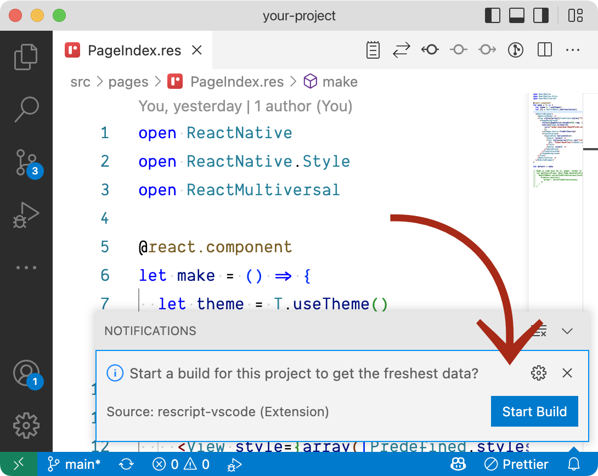

When `rescript`, `@rescript/react` and `rescript-react-native` are installed, you
can run:

```console
npm run res:build
```

⚠️ _If this process looks fast to you, don't be surprised — ReScript is fast!_

This command compiles all `.res` files to their `.res.js` counterparts.

This means if you have an `src/App.res` file, you should now have `src/App.res.js`
as well.

You may also notice some compilation artifacts:

- `lib/`
- `*.res.js` / `*.res.js.map`
- `.bsb.lock` (legacy lock file name still used by some tooling)

You may want to gitignore these:

```
lib/
*.res.js
*.res.js.map
.bsb.lock
```

_If you used our template, this should already be done._

## Automate compilation of `*.res` files

You have multiple ways to avoid thinking about compilation for your daily
workflow.

## Compile ReScript files via IDE

To get the best development experience possible, we recommend
[VSCode](https://code.visualstudio.com) with the
[ReScript plugin](https://marketplace.visualstudio.com/items?itemName=chenglou92.rescript-vscode).

⚠️ If you don’t want to use VSCode, we still recommend you
[get a ReScript editor plugin](https://rescript-lang.org/docs/manual/latest/editor-plugins).

🎉 **By having an IDE that handles ReScript compilation, you will not have to run a
command in the terminal** for day-to-day edits & can follow the standard
React Native workflow, your ReScript files being compiled to JavaScript.

_You will also have inline errors & more features than a pure CLI workflow._

## VS Code workflow

When you open VS Code with the ReScript plugin, you won't have to do anything.
The plugin will detect ReScript & will offer you to handle compilation by just clicking a button.



⛑ _Even if you decide to use VS Code or a similar IDE to ease your day to day
development workflow, you should have a look at the CLI workflow so you know how it
works._

### Compile ReScript files via CLI

When you use React Native, you usually always have a terminal opened with
Metro Bundler running, which bundles the JavaScript files.

You also need a process watching your ReScript files to compile them to
JavaScript. The easiest way is to rely on ReScript's watch option `-w`:

```console
npm run res:watch
```

If you are not familiar with ReScript you should know that you might
sometimes have weird compilation errors due to outdated build artifacts. This
should not happen often but if you face something weird, try cleaning:

```console
npm run res:clean
```

Recommended `package.json` scripts (already included in the template):

```json
{
  "scripts": {
    "res:clean": "rescript clean",
    "res:build": "rescript",
    "res:watch": "rescript build -w",
    "start": "react-native start",
    "ios": "react-native run-ios",
    "android": "react-native run-android"
  }
}
```

#### CLI Development workflow

**In one terminal:**

```console
npm run res:watch
```

As soon as `.res` files are being compiled to `.res.js`, you can start Metro and
the app:

**In another terminal:**

```console
npm start
```

Then, in a third terminal (or after Metro is up):

```console
npm run ios
```

or

```console
npm run android
```

These commands should open a simulator/emulator & start React Native
[Metro](https://github.com/facebook/metro). Metro serves the compiled ReScript
code to the React Native client.

Now you can start coding by editing files in `src/`!

[Read more about starting the project in your environment of choice](https://reactnative.dev/docs/set-up-your-environment).

**Note: as soon as you have the app installed in a simulator/emulator, you can
just run**

```console
npm start
```

alongside `npm run res:watch`. This avoids rebuilding the entire native parts &
will just start Metro.

---

## Interoperability with JavaScript

### Using JavaScript components from ReScript

Check out
[ReScript _Import from/Export to JS_](https://rescript-lang.org/docs/manual/latest/import-from-export-to-js).

You can also browse the source of
[rescript-react-native](https://github.com/rescript-react-native/rescript-react-native/tree/main/src)
because that's exactly what this project is doing!

### Using ReScript React Native components from JavaScript

Check out
[ReScript _Import from/Export to JS_](https://rescript-lang.org/docs/manual/latest/import-from-export-to-js).
